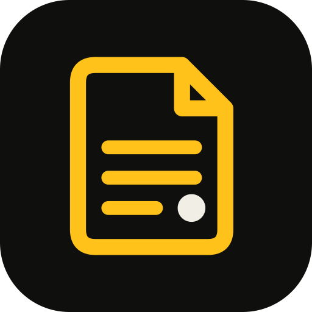

  

<h1 align="center">PDF Reader</h1>

  <b>Read, mark, fill and sign your PDFs, all on your phone.</b> 
  Highlight a bill, fill a government form, sign a letter, read a Malayalam book like a real one. 
  No ads. No tracking. No internet. Just your PDFs.

  
  
  
  
  
  

PDF Reader is a free, open-source PDF viewer and editor for Android.
Part of [Numio](https://getnumio.org) — small, honest apps made by a Keralite.

---

## 📄 Why PDF Reader

Most PDF apps want an account, show ads, upload your files to "the cloud", or lock
editing behind a subscription. PDF Reader is different:

- ✅ **No internet permission at all.** Your bank statements, IDs and contracts never leave your phone.
- ✅ **No storage permission either.** It only sees the PDFs you open with it.
- ✅ **No ads, no accounts, no subscriptions.** Every feature is free.
- ✅ **Free and open source** (GPL-3.0). Anyone can read the code.

## ✨ Features

### 📖 Reading
- ✅ Smooth scrolling, pinch or double-tap to zoom, or **one page at a time**
- ✅ **Book mode**: each page full screen, swipe right to left like a real book, with a
  **reading lock** so a stray touch never changes anything (hold to unlock)
- ✅ 🔍 **Find in the PDF**: every match lit up on the page, with next and previous
- ✅ **Night** and **sepia** pages for reading in bed (only the screen changes, never your file)
- ✅ The PDF's own **contents**, and your own **bookmarks** with names
- ✅ Remembers your place in every PDF; thumbnail strip and *Go to page* for thick books
- ✅ Library with first-page previews, *Continue reading*, Starred, and search by name
- ✅ Light and dark themes, or follow the phone

### 🖍️ Marking
- ✅ Long-press to select text; copy or share it
- ✅ **Highlight** and **underline** in six colours; tap a mark later to recolour or remove it
- ✅ **Pen** for circling, ticking and scribbling
- ✅ **Text boxes**: drag to move, pinch to resize, with an optional white background
- ✅ **Sticky notes**
- ✅ Saved as real PDF annotations, so they show up in Adobe, Chrome and other apps too

### ✍️ Editing, forms and signing
- ✅ **Change or remove the page's own words**: the old text is really taken out of the PDF,
  not just covered with a white box
- ✅ **Fill forms**: text boxes, tick boxes, choices (tested on US government forms)
- ✅ **Sign**: draw, type in a handwriting style (Malayalam too), or reuse a saved signature
- ✅ Saved signatures sit behind your **fingerprint or screen lock**
- ✅ Saves into the original file when Android allows it, or as a new copy you place

### 🧰 Everything else
- ✅ Opens PDFs from Files, WhatsApp, Gmail and other apps, and shares them on
- ✅ Undo for every change, and a reminder if you leave without saving
- ✅ A little easter egg 🤫

## 📸 Screenshots

Coming soon.

## 📲 Install

Not released yet. It will come to **F-Droid** and GitHub Releases, like the other Numio apps.

Requires Android 8.0 (Oreo) or newer.

## 🔒 Privacy

PDF Reader has **no internet permission**: it cannot send anything anywhere.
It has no storage permission either; PDFs are opened through Android's own file picker, one at a time.
The recent list, bookmarks, settings and saved signatures are stored only on your phone, inside the app.
Uninstalling PDF Reader removes all of it. Your PDFs themselves are never touched unless you save changes into them.

## 🛠️ Built with

- [Kotlin](https://kotlinlang.org) and [Jetpack Compose](https://developer.android.com/jetpack/compose)
- Android's own PDF renderer (`android.graphics.pdf`) to draw the pages
- [PdfBox-Android](https://github.com/TomRoush/PdfBox-Android) to read text, annotations and forms, and to save changes

## 🙏 Credits and licences

PDF Reader stands on the work of these people and projects. Thank you.
Full licence texts are in the [licenses](licenses/) folder.

| What | By | Licence | Used for |
|---|---|---|---|
| [PdfBox-Android](https://github.com/TomRoush/PdfBox-Android) (based on [Apache PDFBox](https://pdfbox.apache.org/)) | Tom Roush; The Apache Software Foundation | [Apache 2.0](licenses/Apache-2.0.txt) | Reading text, marks and forms; saving changes into the PDF |
| [Inter](https://rsms.me/inter/) | Rasmus Andersson | [SIL OFL 1.1](licenses/Inter-OFL.txt) | The app's lettering |
| [AndroidX](https://developer.android.com/jetpack/androidx) (Jetpack Compose, Material 3, Core, Lifecycle, Activity) | Google / The Android Open Source Project | [Apache 2.0](licenses/Apache-2.0.txt) | App UI |

Malayalam and other scripts, and the typed-signature styles, use your phone's own fonts; none are bundled.

## 📄 Licence

PDF Reader is free software: you can redistribute it and/or modify it under the terms of the
[GNU General Public License v3.0](LICENSE).

## 🤝 Contributing

Found a PDF that opens wrong, or a form that won't fill?
[Open an issue](https://github.com/rag-creation/numio-pdf/issues), and attach the PDF if it isn't private.

---

Built by RR with help from Claude · [Numio](https://getnumio.org) · Made by a Keralite 💛
